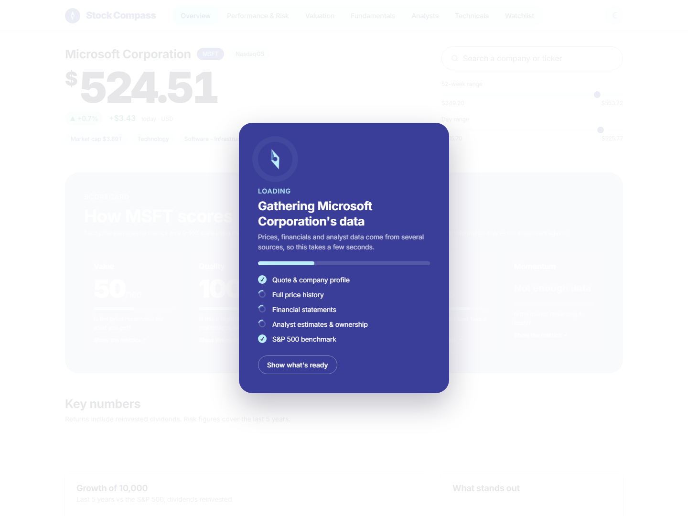
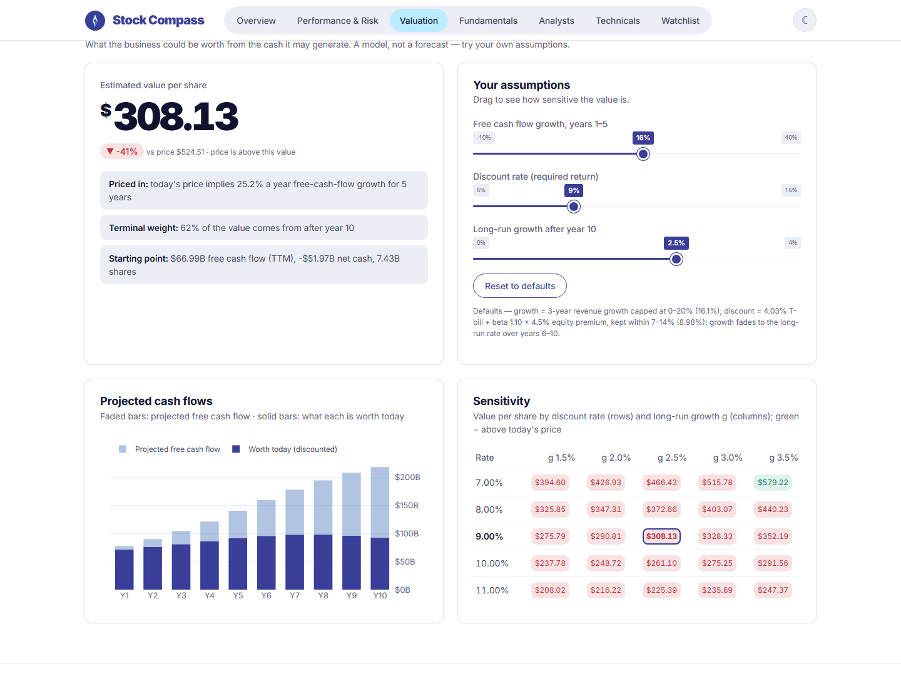
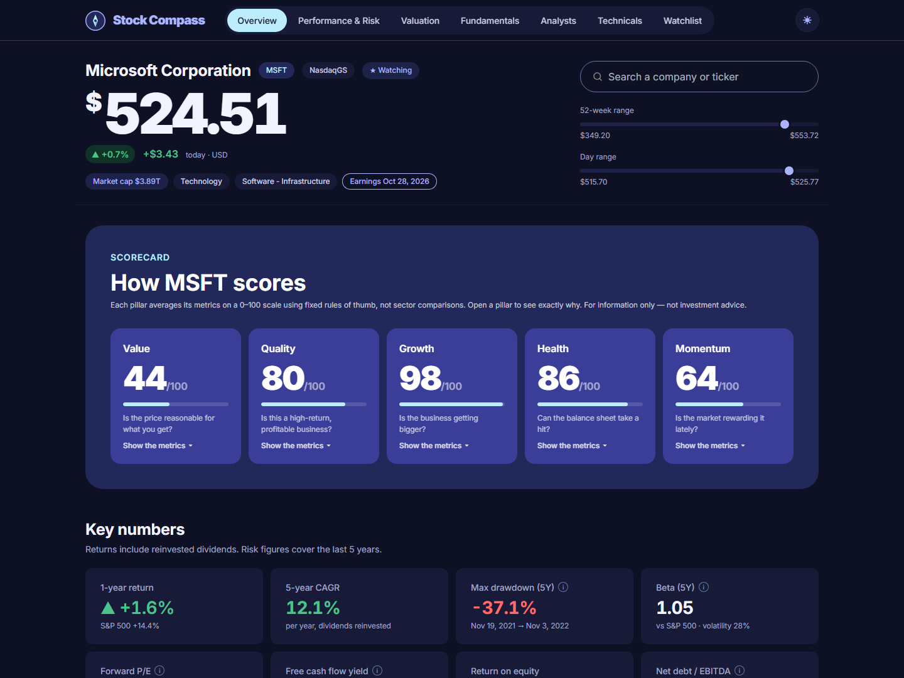

# Stock Compass

**Everything an investor needs to judge a stock, on one page.** Type a ticker and Stock Compass shows how the stock has performed, how risky it has been, whether the price looks reasonable, how strong the business and its balance sheet are, what analysts and insiders are doing, and what the charts say. Each conclusion links back to the numbers behind it.

**Try it live: https://pevolution-ahmed-stock-compass.share.connect.posit.cloud/** (hosted on Posit Connect Cloud's free plan, so the first visit after a quiet spell can take a few extra seconds to wake up).

Built with [Shiny for Python](https://shiny.posit.co/py/), with data from Yahoo Finance.



> **Not investment advice.** Data comes from Yahoo Finance, is delayed by about 15 minutes and is unaudited. Use Stock Compass to research and understand, not as a signal to buy or sell.

---

## Contents

- [Quick start (3 steps)](#quick-start-3-steps)
- [Using the dashboard](#using-the-dashboard)
  - [Finding a stock](#finding-a-stock)
  - [The scorecard](#the-scorecard)
  - [Tab by tab](#tab-by-tab)
  - [Watchlist](#watchlist)
  - [Light and dark mode](#light-and-dark-mode)
- [Key terms in plain English](#key-terms-in-plain-english)
- [Settings](#settings)
- [Troubleshooting](#troubleshooting)
- [For developers](#for-developers)
- [Versions and license](#versions-and-license)

---

## Quick start (3 steps)

You need **Python 3.11 or newer** ([download](https://www.python.org/downloads/); tested with 3.11) and an internet connection.

**1. Get the code.**

```bash
git clone https://github.com/pevolution-ahmed/stock-compass.git
cd stock-compass
```

**2. Install.** This creates a private Python environment in a `.venv` folder, so nothing else on your computer is affected.

Windows:

```powershell
python -m venv .venv
.venv\Scripts\python -m pip install -r requirements.txt
```

macOS / Linux:

```bash
python3 -m venv .venv
.venv/bin/python -m pip install -r requirements.txt
```

<details>
<summary>Prefer <code>uv</code>? (faster)</summary>

```bash
uv venv --python 3.11 .venv
uv pip install --python .venv -r requirements.txt
```
</details>

**3. Run.** The `-b` flag opens the dashboard in your browser.

```bash
# Windows
.venv\Scripts\python -m shiny run app.py -b

# macOS / Linux
.venv/bin/python -m shiny run app.py -b
```

The dashboard opens at **http://127.0.0.1:8000**. To stop it, press `Ctrl+C` in the terminal. Next time, only step 3 is needed.

---

## Using the dashboard

### Finding a stock

- **Search:** type a company name or ticker into the search box at the top right, such as `apple`, `NVDA` or `coca cola`. Pick a result, or press **Enter** to open what you typed as a ticker. Arrow keys move through the results.
- **Quick picks:** click the empty search box to see popular tickers.
- **Share a link:** the address bar always shows the open stock (`?symbol=NVDA`), so you can bookmark or share it.
- **Ticker formats:** Stock Compass uses Yahoo Finance tickers. Non-US stocks need an exchange suffix:

  | Market | Example |
  |---|---|
  | US | `AAPL`, `BRK-B` |
  | London | `SHEL.L` (priced in pence) |
  | Germany (Xetra) | `SAP.DE` |
  | Tokyo | `7203.T` |
  | Toronto | `SHOP.TO` |
  | Crypto | `BTC-USD` |
  | Index | `^GSPC` (S&P 500) |
  | ETF | `SPY`, `QQQ` |

While data loads, a progress card shows each source as it arrives: quote, price history, financial statements, analyst data and the S&P 500 benchmark. It usually takes 1–5 seconds and closes on its own. **Show what's ready** (or `Esc`) closes it early. The first time you open a tab, a small "Loading…" pill appears under the menu while its charts draw.

### The scorecard

The **Overview** tab opens with five scores from 0 to 100, each answering one question:

| Score | Question | What goes into it |
|---|---|---|
| **Value** | Is the price reasonable for what you get? | Forward P/E, EV/EBITDA, free cash flow yield, PEG, P/E compared with its own recent median, DCF margin of safety (price/book for banks) |
| **Quality** | Is this a high-return, profitable business? | Return on equity, gross, operating and net margin, return on invested capital, cash conversion, Piotroski F-score (return on assets for banks) |
| **Growth** | Is the business getting bigger? | Revenue and earnings growth over the last year and 3 years, analysts' expected EPS growth |
| **Health** | Can the balance sheet take a hit? | Debt/equity, net debt/EBITDA, current ratio, interest coverage, Altman Z-score (equity/assets for banks) |
| **Momentum** | Is the market rewarding it lately? | 12-month momentum, price vs its 200-day average, 50- vs 200-day average, 1-year return vs the S&P 500, analyst estimate revisions |

How the scores work:

- **Each metric gets 0–100 on a straight line** between a "weak" and a "strong" threshold. For example, a forward P/E of 12 or lower scores 100 and 35 or higher scores 0.
- **A score is the average of its metrics.** Missing metrics are left out, not counted as zero.
- **Click any score** to see every metric, its value, its points and the thresholds used.
- **The thresholds are fixed rules of thumb, not comparisons with the company's sector.** A software company and a utility are judged on the same scale, so read the scores as a starting point.
- **Banks and insurers** skip metrics that don't apply to them (EV/EBITDA, current ratio, Altman Z) and use bank-appropriate ones instead.
- **ETFs, indices and crypto** get a Momentum score only.

### Tab by tab

| Tab | It answers | Highlights |
|---|---|---|
| **Overview** | "What's the big picture?" | Scorecard, 8 key numbers, growth of 10,000 over 5 years vs the S&P 500, plain-language highlights, company profile |
| **Performance & Risk** | "What has it returned, and how bumpy was the ride?" | *If you had invested…* calculator (any amount, any start date, with or without reinvesting dividends), returns for every period from 1 month to since listing, volatility, worst drawdown, Sharpe/Sortino/Calmar, beta, value at risk, calendar-year and monthly returns. Choose the risk period with **1Y / 3Y / 5Y / 10Y / Max**. |
| **Valuation** | "Is the price reasonable?" | Price multiples vs their own ~4-year median, valuation history, analyst price targets, and a **DCF** fair value with sliders (see below) |
| **Fundamentals** | "Is the business strong and safe?" | Revenue, profit and free cash flow by year, margins, returns on capital, debt and liquidity, Altman Z-score, the nine Piotroski tests one by one, dividends and buybacks |
| **Analysts** | "What do the experts expect?" | Consensus EPS and revenue estimates, how estimates moved in 90 days, upgrades vs downgrades, earnings surprises, rating mix, recent rating changes, institutional holders, insider trades, short interest |
| **Technicals** | "What are the charts saying?" | Signal summary in plain words, candlesticks with **moving averages**, **Bollinger Bands** or the **Ichimoku cloud**, volume, RSI and MACD, for 6M to 5Y |
| **Watchlist** | "How do my stocks compare?" | Your saved stocks side by side with quick scores and a total-return comparison chart |

**Using the DCF (Valuation tab).** The DCF estimates what the business is worth from the cash it may generate, and compares that with today's price.

- **Starting values:** the sliders start from sensible defaults: recent revenue growth, a discount rate built from the T-bill rate and the stock's volatility, and 2.5% long-run growth. The page explains each default.
- **Try your own assumptions:** drag a slider and the value, projected cash flow chart and sensitivity grid update at once. **Reset to defaults** puts them back.
- **"Priced in"** shows the growth rate today's price already assumes. This is often more useful than the fair value itself.
- **When there's no DCF:** it's skipped for banks, funds and companies with negative free cash flow, and the page says why.



### Watchlist

- **Add a stock** with **☆ Watch** next to its name, or with the search box on the Watchlist tab. Remove one with ✕. You can save up to 12.
- **Open a stock** by clicking its name.
- **Quick scores** use quote and price data only, so they can differ slightly from the full scorecard.
- **Saving:** the list lives in your browser. It survives reloads and restarts, but another browser or device starts from the default list, and clearing site data or using a private window empties it.

### Light and dark mode

Click **☾ / ☀** at the top right. Your choice is remembered per browser. On a first visit, the dashboard follows your system's light/dark setting.



---

## Key terms in plain English

| Term | Meaning |
|---|---|
| **Total return** | Price change plus dividends, as if dividends were reinvested. All returns in the app are total returns. |
| **CAGR** | Compound annual growth rate: the steady yearly rate that gets you from start to end. |
| **Max drawdown** | The largest fall from a peak to a later low. −37% means it once lost over a third of its value before recovering. |
| **Volatility** | How much the price swings, scaled to a year. The S&P 500 is typically around 15–20%. |
| **Beta** | Sensitivity to the market. 1.0 moves with it; 1.5 tends to move 15% when the market moves 10%. |
| **Sharpe / Sortino** | Return earned per unit of risk. Above 1 is strong. Sortino only counts downside swings. |
| **P/E, forward P/E** | Price ÷ earnings per share, using the last 12 months or the expected next 12 months. |
| **EV/EBITDA** | The company's total value (including debt) ÷ its operating earnings. Useful when debt levels differ. |
| **Free cash flow (FCF) yield** | Cash the business generated after investment ÷ market value: the cash return if you owned the whole company. |
| **DCF / reverse DCF** | Discounted cash flow: today's value of future cash flows. The reverse DCF solves for the growth the current price implies. |
| **ROIC** | Return on invested capital: profit earned on all the money (debt + equity) put into the business. Above ~15% suggests a durable edge. |
| **Piotroski F-score** | Nine yes/no tests of profitability, debt and efficiency. 8–9 is strong, 0–2 weak. |
| **Altman Z-score** | A bankruptcy-risk model. Below 1.8 is distress, above 3 is safe. Not used for banks. |
| **RSI** | Relative strength index (0–100). Above 70 is "overbought", below 30 "oversold". |
| **MACD** | A momentum indicator. Crossing above its signal line is read as bullish. |

---

## Settings

Nothing needs configuring to get started. These are optional.

**Environment variables.** Set these before starting the app.

| Variable | What it does | Example |
|---|---|---|
| `COMPASS_THEME` | Color theme: `indigo-sky` (default), `forest-lime`, `midnight-gold`, `graphite-mint`, `plum-peach` or `ocean-coral`. The ☾/☀ switch pairs each with a matching dark theme. | `COMPASS_THEME=midnight-gold` |
| `COMPASS_FIXTURES` | Use recorded data instead of Yahoo, for offline demos and tests. Only `MSFT`, `JPM` and `SPY` are recorded. | `COMPASS_FIXTURES=tests/fixtures` |

How to set one:

```powershell
# Windows PowerShell
$env:COMPASS_THEME = "midnight-gold"; .venv\Scripts\python -m shiny run app.py -b
```

```bash
# macOS / Linux
COMPASS_THEME=midnight-gold .venv/bin/python -m shiny run app.py -b
```

**`compass/config.py`.** Edit this file to change:

- the stock opened by default (`DEFAULT_SYMBOL`) and the benchmark (`BENCHMARK_SYMBOL`, `SPY`)
- the quick-pick tickers and the default watchlist
- how long each kind of data is cached (`CACHE_TTL`): quotes for 60 seconds, prices for 15 minutes, financials for 12 hours

**Other changes:**

- Run on another port: `shiny run app.py --port 8001`.
- Let other devices on your network open it: `--host 0.0.0.0`.
- Change the score thresholds: they're defined in `compass/analytics/scoring.py`, one line per metric.

---

## Troubleshooting

| Problem | What to do |
|---|---|
| `shiny` / `python` is "not recognized" | Use the full path shown in the Quick start (`.venv\Scripts\python -m shiny …`), or make sure Python is installed and on your PATH. |
| A ticker shows "We couldn't find …" | Check the Yahoo format, including the exchange suffix for non-US stocks (see [ticker formats](#finding-a-stock)). Delisted companies (e.g. `TWTR`) have no data. |
| The loading card stays up a long time | Yahoo Finance is responding slowly. After 20 seconds the card says so; click **Show what's ready** to use what has loaded. Repeat visits are fast, because data is cached. |
| Errors mentioning `429` or "Too Many Requests" | Yahoo is rate-limiting your connection. Wait a few minutes. The app caches answers and reuses sessions to stay under the limits. |
| A section says a model "doesn't apply" | Intentional. For example, a DCF isn't meaningful for banks, ETFs or companies with negative free cash flow, so the app explains rather than showing a misleading number. |
| "Address already in use" | Something else is using port 8000. Add `--port 8001` (or any free port). |
| My watchlist disappeared | It's stored in the browser. Clearing site data, private windows or a different browser start from the default list. |
| Numbers for a foreign stock look off | Financial statements in another currency are converted at the live FX rate. If no rate is available, the affected metrics are skipped and the page says why. Please report anything that still looks wrong. |

---

## For developers

### Run the tests

```bash
.venv/Scripts/python -m pip install -r requirements-dev.txt   # macOS/Linux: .venv/bin/python …
.venv/Scripts/python -m pytest
```

- **Unit tests** check every calculation against known answers: returns, risk, DCF and reverse DCF, the F- and Z-scores, scoring, currency conversion and the technical signals.
- **The smoke test** starts the app on recorded data and renders every output for a regular stock, a bank, an ETF and an unknown ticker, failing on any error or empty output.

To refresh the recordings from live Yahoo data:

```bash
.venv/Scripts/python scripts/record_fixtures.py MSFT JPM SPY ^IRX ^TNX
```

During development, `shiny run app.py --reload` restarts the app whenever you save a file.

### How it's organized

```
app.py                   entry point (re-exports compass.app.app)
compass/
  app.py                 page layout; wires every module to the shared state
  config.py              defaults: symbols, benchmark, cache lifetimes
  state.py               per-visitor StockContext: background data fetches + shared calculations
  data/                  the only code that talks to Yahoo
    clients.py             raw requests (live Yahoo, or recorded fixtures)
    normalize.py           turns Yahoo's inconsistent answers into clean records
    provider.py            cached, typed API used by the rest of the app
    cache.py               process-wide cache shared by all visitors
  analytics/             pure calculations (pandas/numpy, no Shiny), unit-tested
    performance.py risk.py fundamentals.py valuation.py dcf.py sentiment.py technicals.py
    metrics.py             the flat metric set everything reads from
    scoring.py             the 0–100 pillar rules and thresholds
  ui/                    presentation helpers
    palette.py             color themes, the single source for CSS and charts
    components.py formatting.py charts.py
  modules/               one Shiny module per feature
    search hero overview performance valuation fundamentals analysts technicals watchlist loader
  www/                   styles (design tokens from DESIGN.md), browser scripts
tests/                   unit tests, end-to-end smoke test, recorded fixtures
docs/images/             README screenshots
```

**How data flows:**

1. You pick a ticker.
2. `StockContext` (`compass/state.py`) starts background fetches through `MarketDataProvider`: quote, prices, statements and analyst data.
3. Each result is cached for all visitors, normalized, and turned into metrics by `analytics/`.
4. Modules read only from the context and render. They never call Yahoo directly, so a slow source delays only the cards that need it.

### Add a new tab

1. Create `compass/modules/my_tab.py`:

   ```python
   from htmltools import tags
   from shiny import module, render, ui

   from ..state import StockContext
   from ..ui import components as c


   @module.ui
   def my_tab_ui():
       return tags.div(c.section("My section", ui.output_ui("content")), class_="page")


   @module.server
   def my_tab_server(input, output, session, ctx: StockContext):
       @render.ui
       def content():
           snap = ctx.snapshot.value()          # waits quietly until the quote has loaded
           return c.kpi("Price", f"{snap.price:,.2f}")
   ```

2. Register it in `compass/app.py`: add `ui.nav_panel("My tab", my_tab_ui("my_tab"))` to the page, and `my_tab_server("my_tab", ctx=ctx)` to `server()`.

Put calculations in `compass/analytics/` (and test them there), and reuse the building blocks in `compass/ui/components.py` (`kpi`, `card`, `section`, `table`, `empty_state`) and the chart builders in `compass/ui/charts.py`. Charts pick up the theme, including dark mode, automatically.

### Change colors

Each theme in `compass/ui/palette.py` is a set of named roles (`ink`, `accent`, `paper`, …). Components and charts only use role names, so adding or editing a theme there restyles the whole app. Every built-in theme passes WCAG contrast checks; keep that in mind when choosing new colors.

### Deploying

`requirements.txt` lists everything the app needs, so it deploys like any Shiny for Python app.

**[Posit Connect Cloud](https://connect.posit.cloud)** (the free plan publishes public apps from public GitHub repos):

1. Sign in with GitHub, click **Publish**, then choose **Shiny**. Allow the Connect Cloud GitHub App to access this repository.
2. Repository: this repo · Branch: `main` · Primary file: `app.py`.
3. Under **Advanced settings**, choose Python **3.11**. No environment variables are required; add `COMPASS_THEME` to pick a theme.
4. Click **Publish**. With **Automatically publish on push** on, every push to `main` redeploys the app.

Optional: in the content's **Runtime** settings, raise **Idle Timeout** (up to 60 seconds) so a warm worker, and its data cache, stays around between visits.

Posit Connect servers and shinyapps.io work too: `rsconnect deploy shiny . --entrypoint app:app`.

---

## Versions and license

| Version | What it is |
|---|---|
| `v1.0.0` | First release: scorecard, seven analysis tabs, watchlist, light and dark mode |

Licensed under the [GNU General Public License v3.0](LICENSE).
